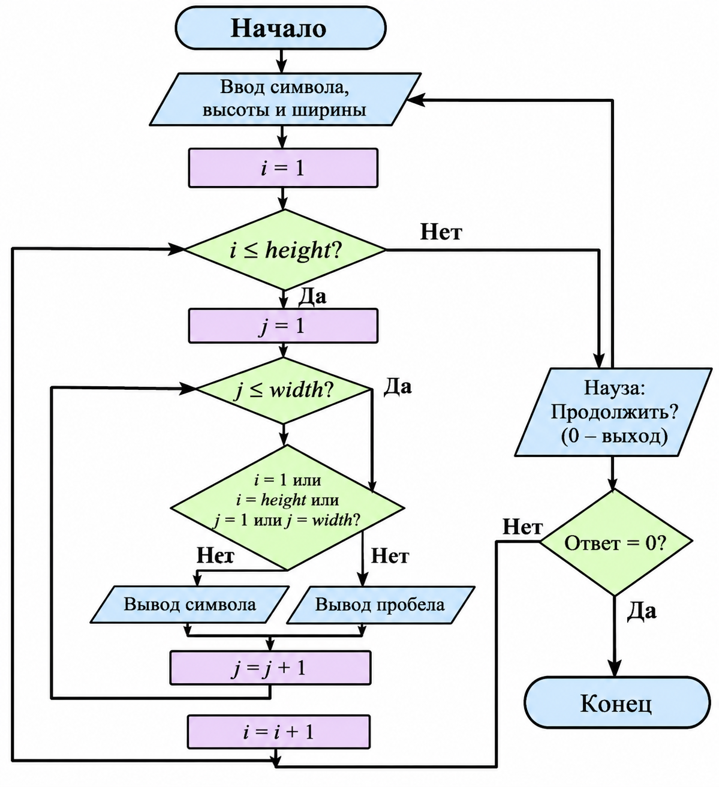

## ДОМАШНЕЕ ЗАДАНИЕ К РАБОТЕ 8

## Условие

Разработать программу на языке C, которая выводит на экран пустой прямоугольник с помощью заданного пользователем символа. Предусмотреть возможность изменения высоты и ширины фигуры.

## 1. Алгоритм и блок-схема

1. Начало программы.
2. Подключение необходимых библиотек и установка русской локали.
3. Объявление переменных:
   - `symbol` — символ для построения прямоугольника;
   - `height` — высота прямоугольника;
   - `width` — ширина прямоугольника;
   - `i`, `j` — счётчики циклов;
   - `answer` — ответ пользователя о продолжении программы.
4. Запуск цикла `do-while`.
5. Ввод символа, из которого будет построена фигура.
6. Ввод высоты прямоугольника.
7. Ввод ширины прямоугольника.
8. Организация внешнего цикла `for` для перебора строк.
9. Организация внутреннего цикла `for` для перебора столбцов.
10. Проверка положения текущего элемента:
    - если строка первая или последняя либо столбец первый или последний, вывести заданный символ;
    - в остальных случаях вывести пробел.
11. Переход на новую строку после завершения внутреннего цикла.
12. Вывод вопроса о продолжении программы.
13. Если пользователь вводит `0`, завершить программу. Иначе повторить построение прямоугольника.
14. Конец программы.

## Блок-схема

[Открыть блок-схему](images/block_scheme.png)

## 2. Реализация программы

## 3. Результат работы программы

Программа для построения пустого прямоугольника. Для создания фигуры используются два вложенных цикла `for`, а с помощью условного оператора `if` определяются границы прямоугольника. Цикл `do-while` позволяет повторять выполнение программы по желанию пользователя.

## Информация о разработчике 
                                Запорин Артём, бТИИ-262