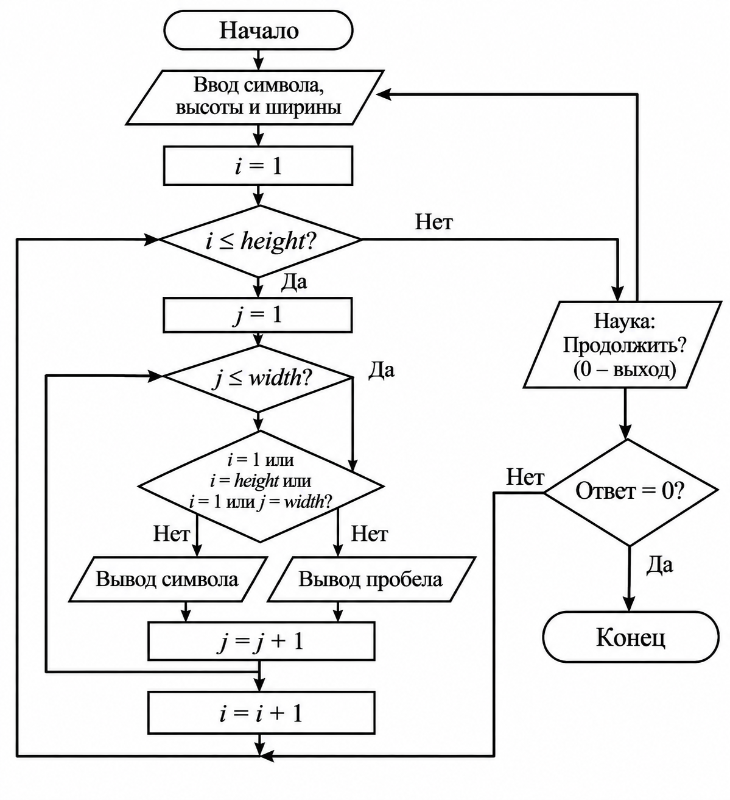

## ДОМАШНЕЕ ЗАДАНИЕ К РАБОТЕ 9

## Условие

Разработать программу на языке C, которая позволяет выполнять операции с перевёрнутым прямоугольным равнобедренным треугольником: вычислять его площадь, выводить определение и рисовать контур с помощью заданного пользователем символа.

## 1. Алгоритм и блок-схема

1. Начало программы.
2. Подключение необходимых библиотек и установка русской локали.
3. Создание функции `area_triangle()` для вычисления площади треугольника.
4. Создание функции `definition()` для вывода определения фигуры.
5. Создание функции `draw_triangle()` для рисования контура треугольника.
6. Ввод длины катета `a`.
7. Вывод меню с тремя вариантами:
   - 1 — рассчитать площадь;
   - 2 — вывести определение фигуры;
   - 3 — нарисовать фигуру.
8. Ввод номера выбранной операции.
9. Выполнение выбранного действия с помощью оператора `switch`:
   - при выборе 1 вычислить и вывести площадь;
   - при выборе 2 вывести определение фигуры;
   - при выборе 3 запросить символ и высоту рисунка, затем нарисовать треугольник.
10. Проверка корректности высоты при рисовании.
11. Завершение программы.

1. Начало программы.
2. Подключение необходимых библиотек и установка русской локали.
3. Создание функции `area_triangle()` для вычисления площади треугольника.
4. Создание функции `definition()` для вывода определения фигуры.
5. Создание функции `draw_triangle()` для рисования контура треугольника.
6. Ввод длины катета `a`.
7. Вывод меню с тремя вариантами:
   - 1 — рассчитать площадь;
   - 2 — вывести определение фигуры;
   - 3 — нарисовать фигуру.
8. Ввод номера выбранной операции.
9. Выполнение выбранного действия с помощью оператора `switch`:
   - при выборе 1 вычислить и вывести площадь;
   - при выборе 2 вывести определение фигуры;
   - при выборе 3 запросить символ и высоту рисунка, затем нарисовать треугольник.
10. Проверка корректности высоты при рисовании.
11. Завершение программы.

## Блок-схема

[Открыть блок-схему](images/12.PNG)

## 2. Реализация программы

## 3. Результат работы программы

Программа для работы с перевёрнутым прямоугольным равнобедренным треугольником. Были созданы отдельные функции для вычисления площади, вывода определения и рисования фигуры. Для выбора операции используется оператор switch, а для построения контура — вложенные циклы for.

## Информация о разработчике 
                                Запорин Артём, бТИИ-262
